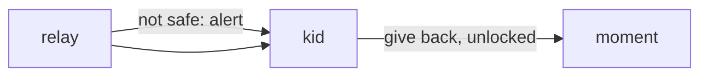

# 0037: what the trip taught

Status: accepted, 2026-10-23. Amends 0013, 0017, 0018, 0020 and 0026.

## Context

A family used a pack for a whole trip on two phones. Six things got in the way: stepping
through the day meant setting a pretend clock and place in Settings, the day's chart drew the
morning's places in the evening, the screen was stale after coming back to the app, editing the
day did not work, the kids' screen and the treasure hunts missed, and a ticket was three or four
taps away when the counter asked for it. Phase 23 fixes what is small; phases 24 to 28 take the
rest, each with its own decision.

## Decision

**Back in front, the screen is redrawn.** The `watch` timer of 0013 runs on uptime and stalls
while the phone sleeps, so the host also redraws on every resume.

**The chart is the day from now on.** Past blocks are left out; it is for planning what is left.

**A ticket in one tap.** The moment screen lists the papers of this block's booking, then the
next block's; the morning screen lists the first block's. Each opens the file. The file stays on
screen, bright and awake, while it shows.

**A child holds the phone anywhere; adults decide.** Where it is not safe the relay says so and
lets the hand-off go on. The `complete` screen and its extra time are gone, and a block that
names a child as `guide` or `for` lands on the kid screen with what it proposes for them. Giving
the phone back still takes a parent's unlock.

## Consequences

- `holder_until` stays in the `people` module for a template that wants a turn with an end;
  travel no longer stores it.
- A pack whose child blocks used `suggestion` to reach the kid screen now gets the kid screen
  directly; adults still get `suggestion`.
- No travel screen sets `alarm` any more, so travel never pins the app; the host keeps the
  alarm and the pin for a template that does.
- Coming back to the app costs one engine call.
