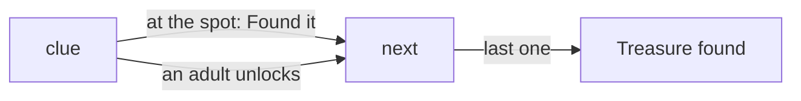

# 0040: a treasure hunt, one clue at a time

Status: accepted, 2026-10-27. Amends 0017, 0020 and 0031.

## Context

On the trip a hunt was a place's points with "Clue 1", "Clue 2" in their kid text. The kid screen
listed them all at once, each under the name that answered it, and the map showed every spot.
Nothing was kept, so a hunt split by lunch started over. And the position counted from the raw
fix: a vague one put the phone in or out of a place at random.

## Decision

**A point with a `clue` is a step of the place's hunt**, in the order of its points. The `places`
module gives `hunt`: `step`, `of`, the next `clue`, `there`, `done` and the points `found`, null
when no point has a clue. How many are found is the fact `hunt.<place>`, so it outlives the block.

**One clue at a time, nothing that spoils it.** The kid screen shows the clue, not the place's map
and not its clue points; a point found shows with its name and kid text. Points with no clue stay
as they were.

**Found at the spot, or on an adult's word.** The next clue's `at` is the region to watch, 30 m
when it gives no `radius_m`. There the child taps "Found it"; anywhere else an adult unlocks the
phone to say so.

**The fix's accuracy is the margin.** A region is reached when the fix is within its radius plus
the accuracy. A fix vaguer than 100 m moves the dot on a map, never from one place to another.
A screen that watches a new region, the next spot, checks the last fix against it at once.

## Consequences

- A clue point may carry `radius_m`; other points still may not.
- A pack's hunt has to say its clues with `clue`; kid text that numbers them is just kid text.
- There is no way to start a hunt over from the phone; the fact goes with a fresh install.
