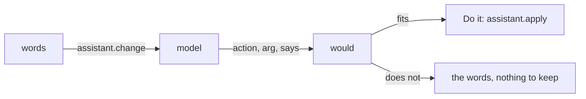

# 0041: an assistant online

Status: accepted, 2026-10-27. Amends 0027.

## Context

On the trip, changing the day meant reaching the code, and the phones had network but no laptop.
One of the two phones has no model of its own, so 0027's assistant was not there at all.

## Decision

**The phone's own model first; online only where there is none.** On a phone with no model,
Settings offers Claude or OpenAI with the person's own key. The key is sealed like a pack's secret,
in its own folder, and sent only to that company. Turning it off forgets the key; a key the
company turns down is forgotten and said so. Either model makes `can.assistant` true, so the free
questions of 0027 use it too.

**This is the one path where facts leave the phone,** and only when the person asks. Settings says
so. What goes is what the pack chose: the day and the words typed.

**A change is proposed, never made.** `assistant.change` takes `request`, `facts` and `actions`, a
text in the pack's words that names the actions offered and their arguments. The host's orders ask
for one action with its argument and a sentence for the person. The host checks it with `would`:
it fits only when the engine would store something. `then` gets `{says, fits}`. Nothing is kept
until `assistant.apply` runs the action, which the template puts on a "Do it" button.

**Each company's flagship, at low effort,** with the reply held to a JSON schema; the phone's
model gets the same orders with no schema. Claude declines a safety check would make go to the
model Anthropic picks (`fallbacks: "default"`). Plain HTTP, no SDK: two companies, one request
each, and the limits `get` already has.

## Consequences

- The template's `adjust` offers `move`, `resize`, `drop`, `restore` and `insert`; `drop` and
  `restore` take `$arg.block`, else the picked block.
- One action a request; "and also" is a second request.
- A newer pack from a model is not here: a pack is code, and a phone cannot review it.
- The online path is checked by hand with a key; the flows run with no model.
