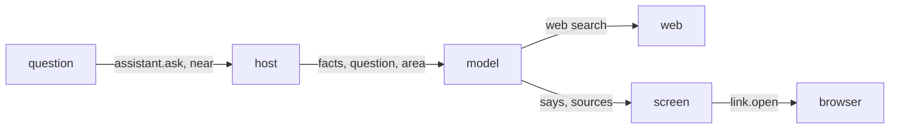

# 0043: a question searched on the web

Status: accepted, 2026-10-29. Amends 0041.

## Context

On the trip the question asked most was what else there is nearby: a place to eat, a pharmacy, an
alternative to a closed museum. The pack does not know, and 0041's model only read the day.

## Decision

**A free question online may search the web.** `assistant.ask` turns on each company's own web
search (Claude `web_search`, at most three searches; OpenAI `web_search`). The orders say to answer
from the facts first, and to search near the area given when the question is about places.

**The area, not the position.** With a position, the host asks the phone's geocoder for the
neighbourhood, city and country and sends that; with none, the place the pack names in `near`.
The geocoder is only asked for a search, so with the phone's own model nothing leaves the device.
Settings says the area goes too.

**The pages come back with the words.** `then` gets `{says, sources}`, each source `{title, url}`,
https only, once each; links are taken out of the words. `link.open` opens an https page in the
browser.

**A change stays without web**, and so does the phone's own model. Both screens show "Thinking…"
while waiting and "No answer came" when the reply is empty.

## Consequences

- The search is the company's, on the person's key, and costs what that company charges for it.
- A long search can still run out the minute `post` waits; then there is no answer, and the person
  asks again.
- Checked by hand with a key; the flows run with no model.
